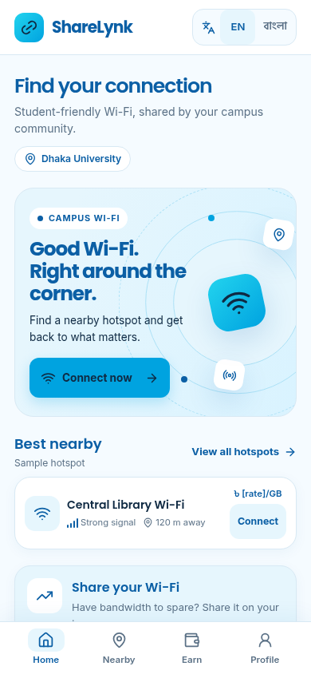
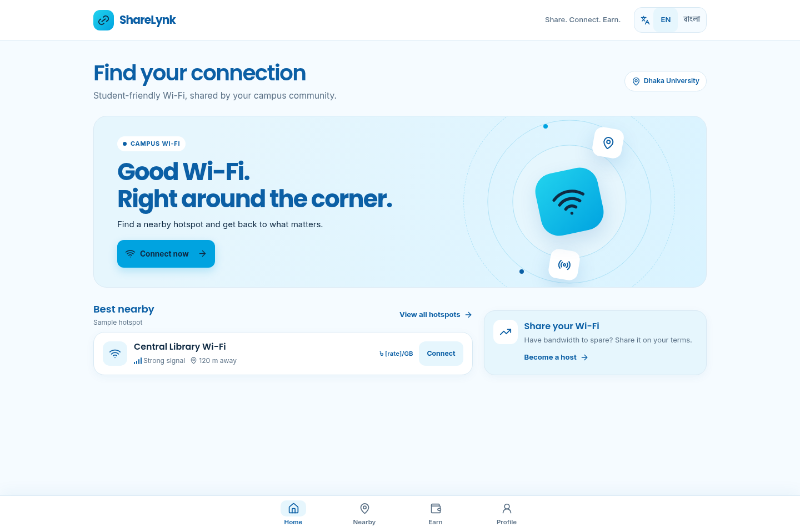

# ShareLynk

**Share. Connect. Earn.** A mobile-first prototype for a student connectivity marketplace at Dhaka University. Students can browse campus hotspots and simulate a connection. Wi-Fi owners can review consent and explore sharing controls and earnings.

## Run locally

Use Node.js 22.12 or later (or Node.js 20.19+ on the 20.x release line).

```sh
npm ci
npm run dev
```

Open the local address printed by Vite. Use `npm run dev -- --host 0.0.0.0 --port 5173 --strictPort` to run it in a cloud workspace.

```sh
npm run build
npm run preview
```

## Try the prototype

- **Home and Nearby** show sample hotspot names, signal strength, and distances. Start a demo session to see the running timer and disconnect.
- **Profile → Start walkthrough** opens the splash and the three onboarding steps.
- **Home → Become a host** opens consent. Agree explicitly to unlock the pause switch. Bandwidth and schedule controls save for the current page load.
- **Earn → Withdraw** previews bKash and Nagad options. The wallet uses placeholders for balances, earnings, and history.
- Use **EN / বাংলা** in the header to switch languages at any step.

The prototype opens on Home for quick exploration. Session and host settings reset on reload. The sample map, Wi-Fi sessions, host controls, approval status, usage, and payments are local demos. Prices and other monetary values use labeled placeholders.

Theme tokens live in [src/theme.css](src/theme.css), copy in [src/translations.js](src/translations.js), and fixtures in [src/mock.js](src/mock.js). The temporary cyan link mark and dark-blue wordmark live in the `Brand` component, ready for the official logo asset.

## Screenshots

### Home at 390px



### Desktop Home


